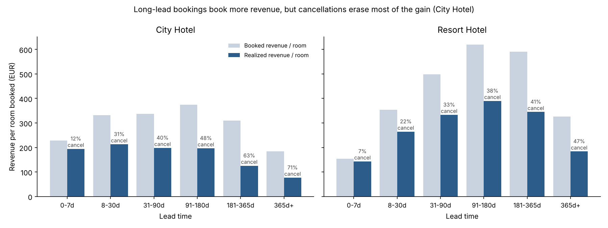

# Hotel Bookings: Which Bookings Actually Make Money After Cancellations?

> **Status:** work in progress. Data quality, two-level grain and descriptive findings are done; the cancellation model, policy simulation and A/B test design are next.

## TL;DR
- **Question:** After cancellations are taken into account, which booking segments bring in the most realized revenue, and what policy should apply to high-risk bookings?
- **Answer (so far):** The City Hotel keeps only 57% of the revenue it books. Bookings made more than 180 days ahead realize the least per room (€77–126 vs ~€200), because 63–71% of those rooms are cancelled.
- **Recommendation:** _pending the cancellation model and policy simulation._

## Business context
Long-lead bookings often pay a higher ADR, but they also cancel more often. Judging a channel or lead-time bucket on ADR or conversion alone can overstate its value. This project measures **realized revenue per booking** (ADR × nights × probability of not cancelling) and tests whether a targeted deposit or overbooking policy would pay off.

## Data
- **Source:** Antonio, N., Almeida, A., & Nunes, L. (2019). *Hotel booking demand datasets.* Data in Brief, 22, 41–49. CSV taken from the TidyTuesday 2020-02-11 mirror (`scripts/download_data.py`).
- **Scope:** 119,390 bookings from two hotels in Portugal (City Hotel 79,330, Resort Hotel 40,060), arrivals from 2015-07-01 to 2017-08-31.
- **Grain:** one row per booking record. There is **no booking ID**.

## Data quality checks
All counts come from `sql/01_data_quality.sql` and `sql/02_duplicate_diagnostic.sql`.

| Check | Rows | Decision |
|---|---:|---|
| Exact duplicate rows (extra copies) | 31,994 | See below: this is the main decision |
| Zero guests (adults + children + babies = 0) | 180 | Exclude |
| Zero nights | 715 | Exclude: all have ADR = 0, so there is no stay to earn revenue on |
| ADR < 0 | 1 | Exclude |
| ADR = 0 | 1,959 | 715 overlap with zero nights (excluded). The rest are kept as genuine zero-revenue stays, mostly the Complementary segment |
| ADR > 1,000 | 1 | Exclude (outlier) |
| `children` missing | 4 | Treat as 0 |
| Market segment / channel = Undefined | 7 | Exclude |
| `country` missing | 488 | Keep, label "Unknown" |
| `agent` / `company` missing | 16,340 / 112,593 | Missing means no agent/company, not missing data |
| `reservation_status` vs target mismatch | 0 | Confirms it leaks the target: never use it as a feature |

### The duplicate problem
The 31,994 extra copies are concentrated in group and agency bookings, so they look like separate rooms in one block rather than ingestion errors. They change the story a lot:

| Deposit type | Segment | Rows in duplicate groups | Cancel % (all rows) | Cancel % (unique rows only) |
|---|---|---:|---:|---:|
| Non Refund | Groups | 98.4% | 99.3% | 84.8% |
| Non Refund | Offline TA/TO | 98.8% | 99.9% | 94.8% |
| No Deposit | Groups | 72.5% | 28.3% | 12.0% |
| No Deposit | Online TA | 14.6% | 36.6% | 34.5% |

The overall cancel rate is 37.0% on all rows and 27.5% after removing duplicates. Read naively, the data says "non-refundable bookings cancel 99% of the time," which is a property of a few large group blocks, not of the deposit policy itself.

**Analysis grain decision: two levels.** After exclusions, 118,558 rows remain and collapse to 86,632 distinct booking records.
- **Room level** (`bookings_room`, every row kept): used for revenue. Each copy is a room that would have earned money, so dropping copies would understate revenue.
- **Block level** (`bookings_block`, identical rows merged, `n_rooms` kept): used for cancellation *behaviour* and modelling. A 40-room group block is one decision to cancel, not 40, so it should not dominate the model.

Both cancel rates are reported side by side. Where they diverge, the gap is the group-block effect.

## Method
| Metric | Definition |
|---|---|
| Booked revenue per room | ADR × nights, over all rooms booked |
| Realized revenue per room | ADR × nights × (1 − is_canceled), over all rooms booked. No-shows count as 0 (conservative: the data does not say whether they were charged) |
| Revenue kept % | Σ realized ÷ Σ booked |
| Cancel % (room) | Share of rooms cancelled: what hits inventory and revenue |
| Cancel % (block) | Share of distinct booking records cancelled: booking behaviour |

Lead-time buckets: 0–7, 8–30, 31–90, 91–180, 181–365, 365+ days. All metrics come from `sql/05_metrics.sql`; result tables are in `outputs/tables/`.

_Next: cancellation model on the block table with a time-based split (train 2015–2016, test 2017), using only fields known at booking time._

## Findings


**1. The City Hotel keeps only 57% of the revenue it books; the Resort keeps 67%.** City cancels 41.9% of rooms (30.2% of booking records) versus 28.0% (23.7%) at the Resort.

**2. At the City Hotel, booking further ahead does not earn more per room.** Booked revenue per room rises from €228 (0–7 days) to €375 (91–180 days), but cancellations rise from 12% to 48%, so realized revenue stays flat at about €195–213 across every bucket up to 180 days. Past 180 days it collapses to €126 and then €77, with 63–71% of rooms cancelled.

**3. At the Resort, longer lead times do pay off, up to six months.** Realized revenue per room climbs from €143 to €390 at 91–180 days, mainly because guests who book early stay longer (1.9 → 5.7 nights). The Resort's lead-time problem is mostly confined to bookings made more than a year ahead.

**4. Online travel agencies bring in the most revenue and lose the most.** Online TA is 52.7% of realized revenue but 61.2% of all revenue lost to cancellation (36.9% of rooms cancelled). Direct bookings carry a similar ADR (€117 vs €118) with only 15.5% cancelled, giving the highest realized revenue per room of any large segment (€329 vs €244).

**5. The "Groups cancel 61% of the time" headline is a block effect.** Counted by room, Groups cancel 61.2%; counted by booking record, 27.2%. A handful of large cancelled blocks drive the room-level number, so a policy aimed at "group guests" in general would hit the wrong customers.

_Interpretation caution: these are associations. Lead time, season and segment move together, so finding 2 is not proof that long lead time causes cancellation. The model step controls for these jointly._

## Recommendation and how to test it
_TODO: policy, A/B test design, primary metric (realized revenue per booking), guardrails (conversion, cancellation)._

## Limitations
- No booking ID, so duplicate rows cannot be told apart from separate rooms with certainty.
- Two hotels in one country; results may not generalize.
- The data only contains bookings that were made, not searches or abandoned bookings, so it says nothing about conversion.

## How to run
```bash
pip install -r requirements.txt
python scripts/download_data.py   # only if data/raw/hotels.csv is missing
python scripts/build_db.py        # rebuilds hotel.duckdb from sql/*.sql
```

## Repo structure
```
data/raw/            raw CSV (committed, ~17 MB)
sql/                 numbered SQL steps, run in order by build_db.py
scripts/             download + build scripts
notebooks/           analysis notebooks
outputs/tables|charts  small result files shown in this README
```
