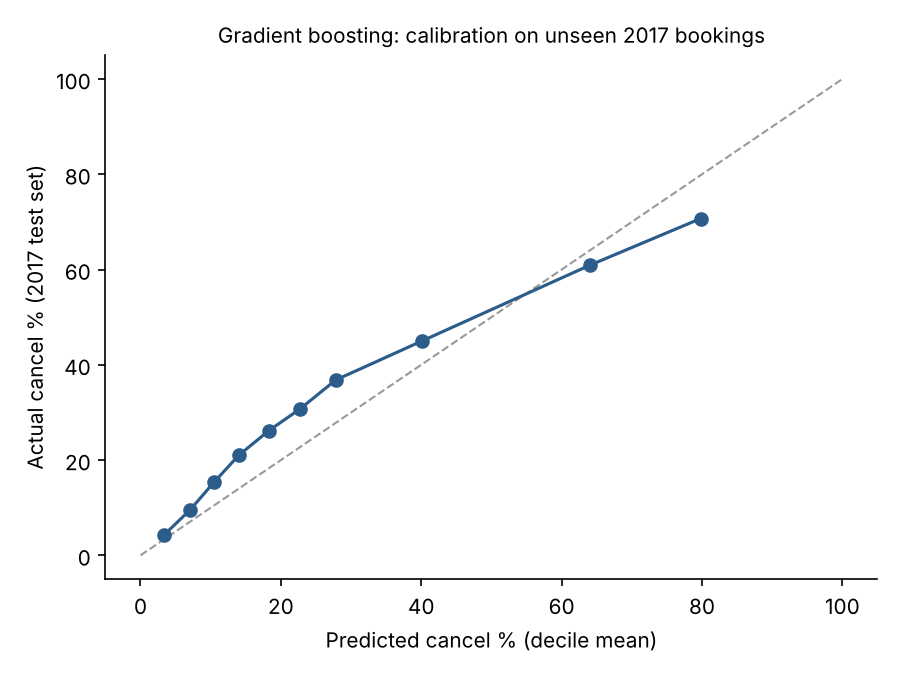
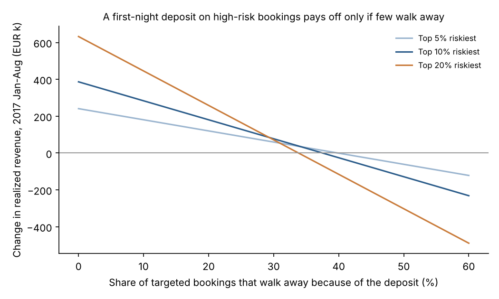

# Hotel Bookings: Which Bookings Actually Make Money After Cancellations?

## TL;DR
- **Question:** After cancellations are taken into account, which booking segments bring in the most realized revenue, and what policy should apply to high-risk bookings?
- **Answer:** The City Hotel keeps only 57% of the revenue it books. A cancellation model trained on 2015–2016 picks out bookings on unseen 2017 data where 71% go on to cancel (vs 32% overall).
- **Recommendation:** Test a first-night deposit on the 10% riskiest no-deposit bookings. In simulation it adds about €390k (+3.9% realized revenue, Jan–Aug 2017) if nobody walks away, and stays positive unless more than **38%** of those guests abandon the booking. That walk-away rate is the unknown an A/B test must measure.

## Business context
Long-lead bookings often pay a higher ADR, but they also cancel more often. Judging a channel or lead-time bucket on ADR or conversion alone can overstate its value. This project measures **realized revenue per booking** (ADR × nights × probability of not cancelling) and tests whether a targeted deposit or overbooking policy would pay off.

## Data
- **Source:** Antonio, N., Almeida, A., & Nunes, L. (2019). *Hotel booking demand datasets.* Data in Brief, 22, 41–49. CSV taken from the TidyTuesday 2020-02-11 mirror (`scripts/download_data.py`).
- **Scope:** 119,390 bookings from two hotels in Portugal (City Hotel 79,330, Resort Hotel 40,060), arrivals from 2015-07-01 to 2017-08-31.
- **Grain:** one row per booking record. There is **no booking ID**.

## Data quality checks
All counts come from `sql/01_data_quality.sql` and `sql/02_duplicate_diagnostic.sql`.

| Check | Rows | Decision |
|---|---:|---|
| Exact duplicate rows (extra copies) | 31,994 | See below: this is the main decision |
| Zero guests (adults + children + babies = 0) | 180 | Exclude |
| Zero nights | 715 | Exclude: all have ADR = 0, so there is no stay to earn revenue on |
| ADR < 0 | 1 | Exclude |
| ADR = 0 | 1,959 | 715 overlap with zero nights (excluded). The rest are kept as genuine zero-revenue stays, mostly the Complementary segment |
| ADR > 1,000 | 1 | Exclude (outlier) |
| `children` missing | 4 | Treat as 0 |
| Market segment / channel = Undefined | 7 | Exclude |
| `country` missing | 488 | Keep, label "Unknown" |
| `agent` / `company` missing | 16,340 / 112,593 | Missing means no agent/company, not missing data |
| `reservation_status` vs target mismatch | 0 | Confirms it leaks the target: never use it as a feature |

### The duplicate problem
The 31,994 extra copies are concentrated in group and agency bookings, so they look like separate rooms in one block rather than ingestion errors. They change the story a lot:

| Deposit type | Segment | Rows in duplicate groups | Cancel % (all rows) | Cancel % (unique rows only) |
|---|---|---:|---:|---:|
| Non Refund | Groups | 98.4% | 99.3% | 84.8% |
| Non Refund | Offline TA/TO | 98.8% | 99.9% | 94.8% |
| No Deposit | Groups | 72.5% | 28.3% | 12.0% |
| No Deposit | Online TA | 14.6% | 36.6% | 34.5% |

The overall cancel rate is 37.0% on all rows and 27.5% after removing duplicates. Read naively, the data says "non-refundable bookings cancel 99% of the time," which is a property of a few large group blocks, not of the deposit policy itself.

**Analysis grain decision: two levels.** After exclusions, 118,558 rows remain and collapse to 86,632 distinct booking records.
- **Room level** (`bookings_room`, every row kept): used for revenue. Each copy is a room that would have earned money, so dropping copies would understate revenue.
- **Block level** (`bookings_block`, identical rows merged, `n_rooms` kept): used for cancellation *behaviour* and modelling. A 40-room group block is one decision to cancel, not 40, so it should not dominate the model.

Both cancel rates are reported side by side. Where they diverge, the gap is the group-block effect.

## Method
| Metric | Definition |
|---|---|
| Booked revenue per room | ADR × nights, over all rooms booked |
| Realized revenue per room | ADR × nights × (1 − is_canceled), over all rooms booked. No-shows count as 0 (conservative: the data does not say whether they were charged) |
| Revenue kept % | Σ realized ÷ Σ booked |
| Cancel % (room) | Share of rooms cancelled: what hits inventory and revenue |
| Cancel % (block) | Share of distinct booking records cancelled: booking behaviour |

Lead-time buckets: 0–7, 8–30, 31–90, 91–180, 181–365, 365+ days. All metrics come from `sql/05_metrics.sql`; result tables are in `outputs/tables/`.

### Cancellation model
- **Grain:** block table (86,632 booking records), so a 40-room block counts once.
- **Split by time, not at random:** train on arrivals up to 2016 (55,103 records, 25.2% cancelled), test on Jan–Aug 2017 (31,529 records, 32.0% cancelled). A model is only useful if it predicts bookings it has not seen yet.
- **Models:** logistic regression (interpretable baseline) and gradient boosting (`scripts/06_cancellation_model.py`).
- **Leakage: fields excluded on purpose**

| Field | Why it is excluded |
|---|---|
| `reservation_status` | It *is* the outcome (100% agreement with `is_canceled`) |
| `required_car_parking_spaces` | 7,289 records with a parking space have **0.00%** cancellation, so the field is only filled once the guest arrives |
| `country` | May be confirmed at check-in in the hotel's system, so it is not reliably known at booking time |
| `assigned_room_type`, `booking_changes` | Happen after the booking is made |

### Deposit policy simulation (2017 test set)
Policy: charge one night's ADR as a non-refundable deposit to the top *k*% riskiest **No Deposit** bookings; the hotel keeps it if the guest cancels. Two behaviours are unknown, so they are varied rather than assumed:
- **walk-away rate:** share of targeted guests who no longer book because of the deposit (0–60%)
- **cancel reduction:** relative drop in cancellation among those who still book (0% or 25%)

The comparison is against targeting the same number of bookings **at random**, to show what the model adds.

### A/B test sizing
Two-sided α = 0.05, power = 0.80, metric = realized revenue per booking in the top risk decile (mean €182, SD €323).

## Findings


**1. The City Hotel keeps only 57% of the revenue it books; the Resort keeps 67%.** City cancels 41.9% of rooms (30.2% of booking records) versus 28.0% (23.7%) at the Resort.

**2. At the City Hotel, booking further ahead does not earn more per room.** Booked revenue per room rises from €228 (0–7 days) to €375 (91–180 days), but cancellations rise from 12% to 48%, so realized revenue stays flat at about €195–213 across every bucket up to 180 days. Past 180 days it collapses to €126 and then €77, with 63–71% of rooms cancelled.

**3. At the Resort, longer lead times do pay off, up to six months.** Realized revenue per room climbs from €143 to €390 at 91–180 days, mainly because guests who book early stay longer (1.9 → 5.7 nights). The Resort's lead-time problem is mostly confined to bookings made more than a year ahead.

**4. Online travel agencies bring in the most revenue and lose the most.** Online TA is 52.7% of realized revenue but 61.2% of all revenue lost to cancellation (36.9% of rooms cancelled). Direct bookings carry a similar ADR (€117 vs €118) with only 15.5% cancelled, giving the highest realized revenue per room of any large segment (€329 vs €244).

**5. The "Groups cancel 61% of the time" headline is a block effect.** Counted by room, Groups cancel 61.2%; counted by booking record, 27.2%. A handful of large cancelled blocks drive the room-level number, so a policy aimed at "group guests" in general would hit the wrong customers.

_Interpretation caution: findings 1–5 are associations. Lead time, season and segment move together, so finding 2 is not proof that long lead time causes cancellation._

**6. The model ranks risk well enough to act on, but it under-predicts 2017.** Gradient boosting reaches AUC 0.770 on unseen 2017 bookings (logistic regression 0.754). In the top risk decile, 70.7% actually cancelled. The cancel rate drifted up from 25.2% in training to 32.0% in 2017, so the middle deciles are under-predicted by 5–8 points: the model needs regular retraining, and its scores should be used for **ranking**, not as exact probabilities.



| Model | Test AUC | Brier | Predicted cancel % | Actual cancel % | Actual cancel % in top 10% |
|---|---:|---:|---:|---:|---:|
| Logistic regression | 0.754 | 0.178 | 28.7 | 32.0 | 73.7 |
| Gradient boosting | 0.770 | 0.178 | 28.8 | 32.0 | 70.7 |

Strongest signals in the logistic model: previous cancellations by the same guest (+), Online TA segment (+), lead time (+), number of special requests (−), previous completed stays (−).

**7. Targeting is what makes a deposit policy pay.** Deposit on the top 10% riskiest bookings:

| Walk-away rate | Model-targeted (EUR) | Random 10% (EUR) |
|---:|---:|---:|
| 0% | +386,781 | +146,904 |
| 10% | +283,733 | +32,650 |
| 20% | +180,684 | −81,603 |
| 30% | +77,636 | −195,857 |

Applied at random, the same deposit loses money once 20% of guests walk away. Targeted by the model, it breaks even only at a **38%** walk-away rate. If the deposit also makes stayers 25% less likely to cancel, the gain at 0% walk-away rises to +€713k (+7.3%). Full grid: `outputs/tables/policy_simulation.csv`.



## Recommendation and how to test it
**Recommendation:** pilot a first-night deposit for No Deposit bookings in the top 10% of model risk, starting with Online TA and long-lead City Hotel bookings, where most revenue is lost.

**A/B test design**
- **Unit:** booking attempt that scores in the top risk decile at checkout. Randomize 50/50: control = current terms, treatment = first-night deposit.
- **Primary metric:** realized revenue per booking attempt, counting walk-aways as €0. This one number captures both effects: deposits kept on cancellation and guests lost at checkout.
- **Guardrails:** checkout conversion (directly measures walk-away against the 38% break-even), cancellation rate, customer complaints and review scores.
- **Decision rule:** roll out if realized revenue per attempt rises significantly and conversion falls by less than the break-even.
- **Sample size:**

| Minimum detectable lift | Bookings per arm | Weeks at these two hotels' volume |
|---:|---:|---:|
| 5% | 19,696 | 438 |
| 10% | 4,924 | 110 |
| 15% | 2,189 | 49 |

Revenue per booking is very noisy (SD €323 on a €182 mean), so **two hotels alone cannot run this test in reasonable time.** It needs to run across many properties at once (where an OTA has a structural advantage), or use checkout conversion as an earlier read-out, since conversion is a binary metric that needs far fewer bookings.

## Limitations
- No booking ID, so duplicate rows cannot be told apart from separate rooms with certainty.
- Two hotels in one country; results may not generalize.
- The data only contains bookings that were made, not searches or abandoned bookings, so it says nothing about conversion. That is why the walk-away rate is an assumption varied in the simulation and must be measured in the A/B test.
- The simulation assumes guests who walk away are average for the targeted group, and that a cancelling guest who paid a deposit forfeits it in full.
- No-shows are counted as €0 revenue; in reality some may be charged, so realized revenue is slightly understated.
- The 2017 test set covers January to August only, so it under-represents autumn and winter.

## How to run
```bash
pip install -r requirements.txt
python scripts/download_data.py   # only if data/raw/hotels.csv is missing
python scripts/build_db.py        # rebuilds hotel.duckdb from sql/*.sql
python scripts/06_cancellation_model.py   # model, policy simulation, A/B sizing -> outputs/
```

## Repo structure
```
data/raw/            raw CSV (committed, ~17 MB)
sql/                 numbered SQL steps, run in order by build_db.py
scripts/             download, build, and model / simulation scripts
outputs/tables|charts  small result files shown in this README
```
